<div align="center">
  
</div>

<br/>

```text
ANDREI(1)                    Manual do Desenvolvedor                    ANDREI(1)

NOME
       andrei — desenvolvedor full-stack de Criciúma, Santa Catarina 🇧🇷

SINOPSE
       andrei [--front next|react] [--back nest|laravel] [--com-cafe]

DESCRIÇÃO
       Transforma ideias em produtos web, do banco de dados ao último pixel.
       Prefere tipagem forte, componentes pequenos e deploys sem drama.
       Sai do ar por alguns minutos quando o café acaba.

OPÇÕES
       --front     React, Next.js, Tailwind CSS, TypeScript
       --back      NestJS, Node.js, PHP, Laravel
       --extras    Lua (FiveM), visão computacional, Git

PROCESSOS EM EXECUÇÃO
       PID   PROCESSO      DESCRIÇÃO
       001   lmsistemas    desenvolvedor web            desde jan/2026
       002   nextygroup    colaborador
       003   lovvier       plataforma de presentes digitais
       004   tcc           detecção de quedas com visão computacional

HISTÓRICO
       2026–hoje   LMSistemas      desenvolvimento web
       2024–2026   Cooperja        PHP / Laravel
       2023–2026   Unesc           Ciência da Computação

BUGS CONHECIDOS
       Começa um side project novo antes de terminar o anterior.
       Converte café em commits de forma não determinística.

VEJA TAMBÉM
       meneghel.dev(1), linkedin(1), lovvier(1)

Andrei Meneghel                       2026                              ANDREI(1)
```

<div align="center">

[meneghel.dev](https://meneghel.dev) &nbsp;·&nbsp; [linkedin](https://www.linkedin.com/in/andreimeneghel/) &nbsp;·&nbsp; [lovvier](https://lovvier.com) &nbsp;·&nbsp; [@LMSistemas](https://github.com/LMSistemas)

</div>
